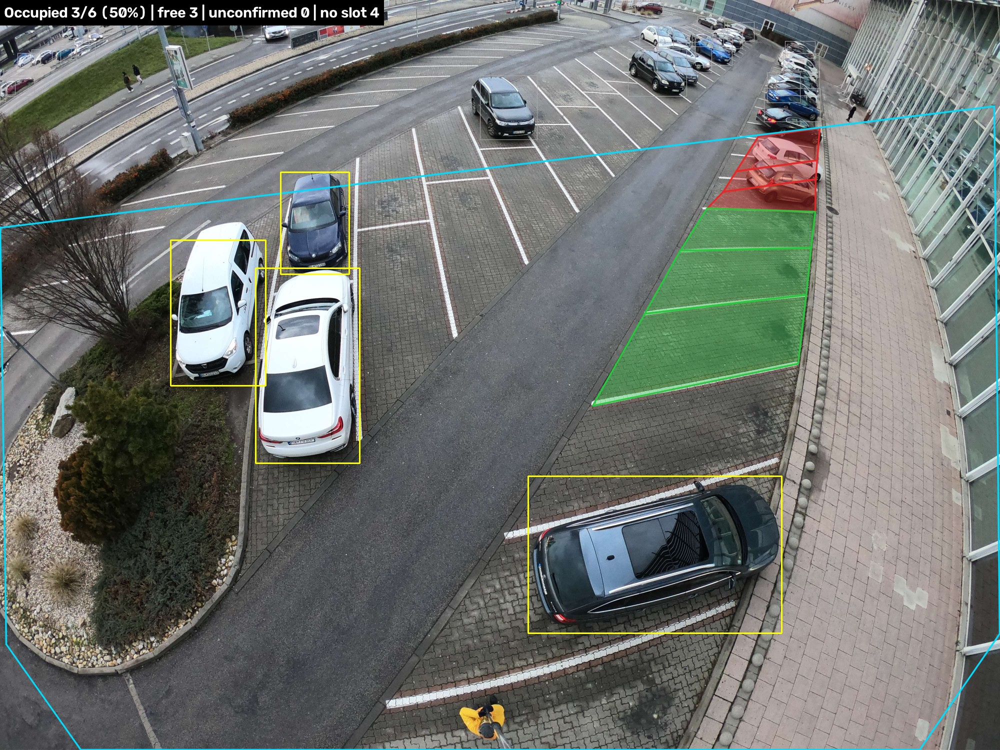
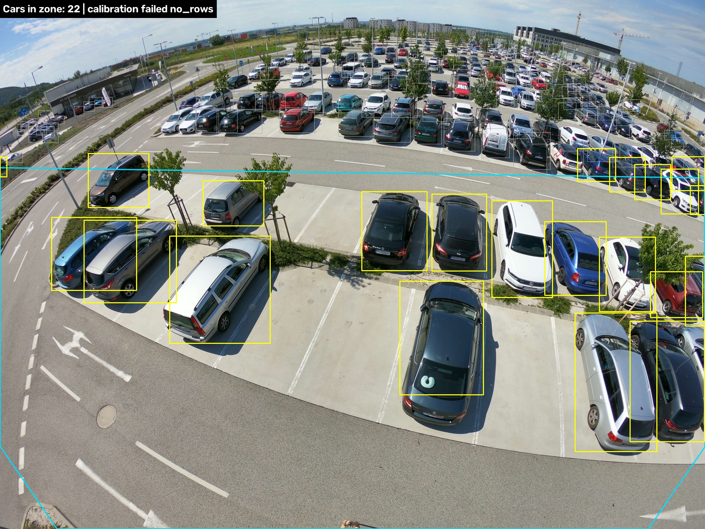

# ParkingScan

Parking occupancy from a single oblique photo of a car park.

ParkingScan detects cars, finds the parking slots **from the painted markings in the same image**, and
reports which slots are occupied. Nobody draws slot polygons by hand: there is no per-site annotation
step, and one photo is enough.



*Occupied slots are red, free slots are green, cars that match no slot are yellow, the cyan outline is
the working zone. Summary: 3 of 6 confirmed slots occupied.*



*On this frame the markings cannot be read, so the system refuses to build a slot grid and reports
only the number of cars in the working zone (`calibration_status: failed`, `occupancy_rate: null`).
It does not invent slots it cannot see.*

Both screenshots are derived from dataset frames, see
[Dataset and image sources](#dataset-and-image-sources).

## Status

| Part | State |
|---|---|
| Car detection (YOLO26s + SAHI) | works |
| Slot grid from painted markings | works, with the limits described below |
| Occupancy, REST API, CLI | works |
| Database of snapshots | **planned, not in the code yet** |
| Number plate recognition (ANPR) | **planned, not in the code yet** |

## How it works

1. **Detection.** A YOLO26s model finds cars. The image is resized to the training scale and processed
   in 640 px tiles with SAHI, because cars in these frames differ in size up to 25 times.
2. **Local scale.** A robust regression over the detected boxes gives the expected car size at every
   point of the frame. All thresholds are fractions of that size, not pixels.
3. **Working zone.** The far field, where markings cannot be read, and the fisheye periphery are cut off.
4. **Markings.** A paint mask (white top-hat with a local threshold) and a line segment detector give
   the slot dividers.
5. **Rows and slots.** Parallel dividers with a regular step form a row; the quadrilateral between two
   neighbouring dividers is a slot. Where parked cars hide the markings, the row is continued with the
   step measured on its visible part, and a cell is accepted only if a car stands in it.
6. **Occupancy.** A slot is occupied when the ground point of a detection (the middle of the bottom
   edge of the box, raised by 15% of its height) lies inside the slot polygon.

Every slot has a `source`: `observed` (both dividers seen), `interpolated`, `projected` (continued
under a car) or `extrapolated` (continued, not confirmed by anything). **`occupancy_rate` is computed
over confirmed slots only**; unconfirmed slots are reported separately and count neither as free nor
as occupied.

## Run with Docker

The model weights (`models/cars_yolo26s_best.pt`, 20 MB) and the inference contract
(`models/config.json`) are part of the repository and are copied into the image. To use other weights,
put them into `models/` together with a matching `config.json` before building.

```bash
docker build -f docker/Dockerfile -t parkingscan .
docker run --rm -p 8000:8000 -v "$(pwd)/data:/app/data" parkingscan
```

Or with Compose:

```bash
docker compose -f docker/docker-compose.yml up
```

The service runs inside the container as an unprivileged user with uid 1000 and writes site
calibrations to `/app/data`. On a Linux host the mounted `data` directory therefore has to be writable
by uid 1000; this case has not been tested, the image was checked with Docker Desktop on Windows.

Then:

```bash
curl http://localhost:8000/health
curl -F "file=@lot.jpg" http://localhost:8000/occupancy/detect
curl -F "file=@lot.jpg" http://localhost:8000/occupancy/render -o result.jpg
```

Interactive API documentation is served at `http://localhost:8000/docs`.

### GPU in Docker — not tested

**The image is built for CPU only.** Running it on an NVIDIA GPU has not been tested, so there is no
GPU image in this repository. The steps it would take:

1. Install the NVIDIA Container Toolkit on the host.
2. In `docker/Dockerfile`, install `torch` and `torchvision` from the CUDA index
   `https://download.pytorch.org/whl/cu130` instead of the CPU index.
3. Run the container with `--gpus all`.

The service picks `cuda:0` automatically when it is available; `/health` shows the device in use.
Outside Docker the GPU path is the one the project is developed on, see below.

## Run without Docker

Requires [uv](https://docs.astral.sh/uv/). The project is developed and tested on Python 3.14;
`pyproject.toml` declares `>=3.12`, but older versions have not been tested.

```bash
uv sync
uv run uvicorn parkingscan.api.app:app --port 8000
```

On Windows and Linux `uv sync` installs PyTorch built for CUDA 13.0, and the service uses the GPU when
one is available; otherwise it runs on CPU. This has been tested on Windows only.

Without the API, for one image or a folder:

```bash
uv run parkingscan lot.jpg
uv run parkingscan photos/ --out rendered/
```

The CLI prints one JSON line per image, the same object that `/occupancy/detect` returns, and with
`--out` saves the rendered images.

## API

| Method | Path | Purpose |
|---|---|---|
| GET | `/health` | Status, device, version |
| POST | `/occupancy/detect` | Image, optional `site_id` and `conf` → occupancy JSON |
| POST | `/occupancy/render` | Same input → image with the overlay (`format`, `max_side`) |
| POST | `/sites/{site_id}/calibrate` | One or more images from a fixed camera → saved slot grid |
| GET | `/sites/{site_id}/slots` | Saved grid |
| PUT | `/sites/{site_id}/slots` | Manual correction of the grid |

Without `site_id` the grid is built from the same image the occupancy is computed on. With `site_id`
the saved grid is used; this is only correct for a camera that does not move.

Calibration status:

- `ok` — at least 3 slots, and at least 60% of them confirmed;
- `partial` — slots were found, but few of them or with low coverage; the grid is used and the reason
  is returned in `calibration_reason`;
- `failed` — no scale (fewer than 5 cars), no markings or no rows; the response contains only the
  number of cars in the working zone, and `occupancy_rate` is `null`.

## Accuracy

Measured on the 35 validation images of the training notebook, which the model has not seen, at the
service threshold `conf = 0.25`.

| Metric | Value |
|---|---|
| Detector F1, whole frame | **0.836** |
| Detector F1, cars larger than 150 px | **0.892** |
| Median absolute error of the car count per image | 7.7% |
| Slot grid recall, two reference frames | **0.50** (9 of 18) and **0.43** (3 of 7) |

**Why there are two F1 values.** The dataset annotation of the far field is incomplete and
inconsistent: on some frames distant cars are not labelled, so correct detections are counted as
errors; on others they are labelled and the model does miss them. The whole-frame figure is therefore
both lowered and noisy. Cars larger than 150 px lie in the zone where the annotation can be trusted,
and 0.892 is the honest figure for the area the system actually analyses.

**Slot grid recall** is the share of parked cars inside the working zone for which a slot was found.
It is 0.50 and 0.43, not close to 1, and the reason is physical rather than a tuning problem; see the
first limitation below.

On an RTX 4070 Ti SUPER detection of a 4000×3000 frame takes about 100 ms; building the grid takes
about 0.7 s on CPU.

## Limitations

- **On oblique handheld photos the grid is partial.** Markings are visible where slots are empty, and
  hidden by car bodies where slots are taken. A row needs at least two visible dividers; without them
  it is not found, and its cars are reported as `unassigned_detections`. This is what limits the grid
  recall above.
- Slots under cars are reconstructed from the step of the visible part of the row, not from their own
  markings.
- A slot without painted markings is never found.
- Worn markings, snow, wet asphalt with glare and night images are not supported.
- The far field outside the working zone is not analysed.
- The detector occasionally takes a non-car object for a car, and such a detection can mark a slot as
  occupied.
- The camera is assumed to be a wide-angle one looking at the car park at an angle, as in the training
  data. The model is tied to that scale.

## Number plates need a separate camera

Plates cannot be read from an overview photo of a car park. This is geometry, not a model limitation:
reliable recognition needs about 100 px across the plate, and in an overview frame only one or two
cars right under the camera get that. The planned ANPR module therefore works from a separate
ground-level camera at the entrance, looking along the lane: plate width of at least 100 px (40 px is
the minimum), an angle to the plate of at most 30° horizontally and vertically, and a capture distance
of 5–15 m. This module is not implemented yet.

## Dataset and image sources

The model was trained on 234 oblique 4000×3000 frames of car parks shot with a wide-angle action
camera. The data comes from the Kaggle competition
[Cars object detection](https://www.kaggle.com/competitions/cars-object-detection).

This is a competition, not a freely licensed dataset: the terms of use of the data are set by the
competition's [Rules](https://www.kaggle.com/competitions/cars-object-detection/rules) page. That is
why the original frames are not included in this repository.

**All images in this repository are derived from frames of that dataset**: the screenshots of the
system at work in `docs/screenshots/`, the training curves and validation mosaics in `training/`, and
the outputs embedded in `notebooks/CarsObjectDetection.ipynb`. The rights to the original images
belong to the dataset author. The reference files `data/samples/ground_truth.json`
and `data/samples/slots_gt.json` are, and the check scripts expect four images next to them. Download
the dataset and copy these files from `train/train/images/` into `data/samples/`:

```
57441ed9-GOPR6559.JPG
ec5a75f7-GOPR6537.JPG
90a19daa-GOPR6757.JPG
f92cc929-GOPR6604.JPG
```

## Tests

```bash
uv run pytest -q
```

The tests are synthetic and need neither a GPU nor the model weights. Two manual checks need the
weights and the images from the dataset:

```bash
uv run python tests/check_detector.py <dataset>/train/train
uv run python tests/check_markings.py <output folder>
```

## License

AGPL-3.0, see [LICENSE](LICENSE). The detector is built on Ultralytics YOLO, which is distributed
under AGPL-3.0, so the whole project is released under the same license. Closed commercial use
requires a commercial Ultralytics license or a different detector.
